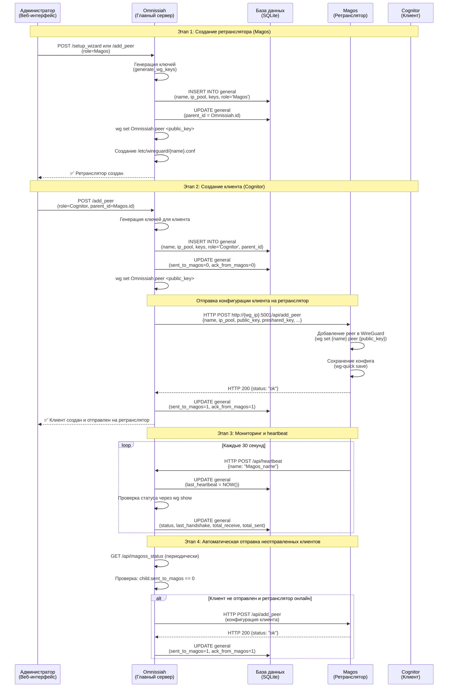
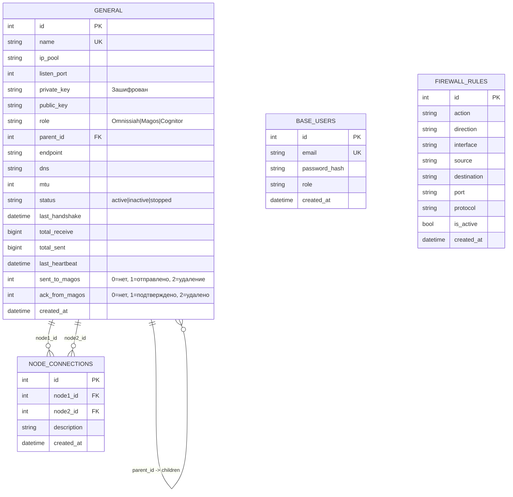
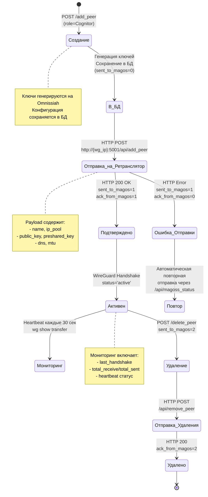

# Архитектура и схемы взаимодействия Omnissiah Network

## 📊 Схема 1: Архитектура взаимодействия компонентов

```mermaid
graph TB
    subgraph "Omnissiah (Главный сервер)"
        Omnissiah[Главный сервер<br/>Omnissiah<br/>Порт: 33787<br/>WireGuard: 51820]
        Omnissiah_DB[(База данных<br/>SQLite<br/>vpngate.db)]
        Omnissiah_Web[Веб-интерфейс<br/>Flask App]
    end

    subgraph "Magos (Ретрансляторы)"
        Magos1[Ретранслятор 1<br/>Magos<br/>API: :5001]
        Magos2[Ретранслятор 2<br/>Magos<br/>API: :5001]
    end

    subgraph "Cognitor (Клиенты)"
        Cognitor1[Клиент 1<br/>Cognitor]
        Cognitor2[Клиент 2<br/>Cognitor]
        Cognitor3[Клиент 3<br/>Cognitor]
        Cognitor4[Клиент 4<br/>Cognitor]
    end

    %% Связи главного сервера
    Omnissiah_Web --> Omnissiah_DB
    Omnissiah --> Omnissiah_DB
    Omnissiah --> Magos1
    Omnissiah --> Magos2

    %% Связи ретрансляторов
    Magos1 --> Cognitor1
    Magos1 --> Cognitor2
    Magos2 --> Cognitor3
    Magos2 --> Cognitor4

    %% HTTP API связи
    Omnissiah_Web -.HTTP POST.-> Magos1
    Omnissiah_Web -.HTTP POST.-> Magos2
    Magos1 -.Heartbeat.-> Omnissiah_Web
    Magos2 -.Heartbeat.-> Omnissiah_Web

    %% WireGuard туннели
    Omnissiah ===|WireGuard|=== Magos1
    Omnissiah ===|WireGuard|=== Magos2
    Magos1 ===|WireGuard|=== Cognitor1
    Magos1 ===|WireGuard|=== Cognitor2
    Magos2 ===|WireGuard|=== Cognitor3
    Magos2 ===|WireGuard|=== Cognitor4

    style Omnissiah fill:#4CAF50,stroke:#2E7D32,color:#fff
    style Magos1 fill:#2196F3,stroke:#1565C0,color:#fff
    style Magos2 fill:#2196F3,stroke:#1565C0,color:#fff
    style Cognitor1 fill:#FF9800,stroke:#E65100,color:#fff
    style Cognitor2 fill:#FF9800,stroke:#E65100,color:#fff
    style Cognitor3 fill:#FF9800,stroke:#E65100,color:#fff
    style Cognitor4 fill:#FF9800,stroke:#E65100,color:#fff
```

## 🔄 Схема 2: Процесс передачи конфигурации и сохранения в БД



## 📋 Схема 3: Структура базы данных



## 🔐 Схема 4: Жизненный цикл конфигурации клиента



## 🔄 Потоки данных

### Поток 1: Создание нового ретранслятора
```
1. Администратор → Omnissiah (POST /setup_wizard)
2. Omnissiah → Генерация ключей WireGuard
3. Omnissiah → БД (INSERT general)
4. Omnissiah → WireGuard (wg set peer)
5. Omnissiah → Файловая система (/etc/wireguard/{name}.conf)
6. Omnissiah → Администратор (ответ успех)
```

### Поток 2: Создание клиента и отправка на ретранслятор
```
1. Администратор → Omnissiah (POST /add_peer, role=Cognitor)
2. Omnissiah → Генерация ключей
3. Omnissiah → БД (INSERT general, sent_to_magos=0)
4. Omnissiah → WireGuard (добавление peer на Omnissiah)
5. Omnissiah → Magos (HTTP POST /api/add_peer)
   └─ Payload: {name, ip_pool, public_key, preshared_key, dns, mtu}
6. Magos → WireGuard (wg set peer)
7. Magos → Omnissiah (HTTP 200 OK)
8. Omnissiah → БД (UPDATE sent_to_magos=1, ack_from_magos=1)
9. Omnissiah → Администратор (ответ успех)
```

### Поток 3: Мониторинг и синхронизация
```
1. Magos → Omnissiah (HTTP POST /api/heartbeat каждые 30 сек)
2. Omnissiah → БД (UPDATE last_heartbeat)
3. Omnissiah → WireGuard (wg show {name} transfer)
4. Omnissiah → БД (UPDATE total_receive, total_sent, last_handshake)
5. Omnissiah → Проверка неотправленных клиентов
6. Если клиент не отправлен и ретранслятор онлайн:
   └─ Omnissiah → Magos (HTTP POST /api/add_peer)
   └─ Обновление флагов в БД
```

## 📐 Текстовая схема архитектуры (ASCII)

```
┌─────────────────────────────────────────────────────────────┐
│                    Omnissiah (Главный сервер)                  │
│  ┌──────────────────┐         ┌──────────────────┐          │
│  │  Flask Web App  │─────────▶│   SQLite DB     │          │
│  │   Port: 33787   │         │  vpngate.db     │          │
│  └────────┬────────┘         └──────────────────┘          │
│           │                                                   │
│  ┌────────▼────────┐                                         │
│  │ WireGuard Omnissiah   │                                         │
│  │ Port: 51820      │                                         │
│  └──────────────────┘                                         │
└─────────────────────────────────────────────────────────────┘
           │                          │
           │ WireGuard                │ WireGuard
           │ Tunnel                   │ Tunnel
           ▼                          ▼
┌──────────────────┐         ┌──────────────────┐
│  Magos Relay 1 │         │  Magos Relay 2 │
│  API: :5001      │         │  API: :5001      │
└────────┬─────────┘         └────────┬─────────┘
         │                            │
         │ WireGuard                   │ WireGuard
         │                            │
    ┌────▼────┐  ┌────▼────┐    ┌────▼────┐  ┌────▼────┐
    │ Cognitor C1  │  │ Cognitor C2  │    │ Cognitor C3  │  │ Cognitor C4  │
    └─────────┘  └─────────┘    └─────────┘  └─────────┘

Коммуникация:
  ──── WireGuard VPN туннели (шифрованные)
  ┄┄┄┄ HTTP API запросы (конфигурация)
  ════ Heartbeat (мониторинг)
```

## 📋 Текстовая схема потока данных конфигурации

```
ШАГ 1: Создание ретранслятора (Magos)
┌────────────────────────────────────────────────────────────┐
│ Admin → Omnissiah: POST /setup_wizard {role: "Magos", ...}    │
│                                                             │
│ Omnissiah выполняет:                                             │
│   1. Генерация ключей (wg genkey)                          │
│   2. DB: INSERT INTO general                               │
│      - name, ip_pool, keys, role='Magos'                │
│      - parent_id = Omnissiah.id                                  │
│   3. wg set Omnissiah peer {public_key}                         │
│   4. Создание /etc/wireguard/{name}.conf                  │
│                                                             │
│ Omnissiah → Admin: ✅ Ретранслятор создан                        │
└────────────────────────────────────────────────────────────┘

ШАГ 2: Создание клиента (Cognitor)
┌────────────────────────────────────────────────────────────┐
│ Admin → Omnissiah: POST /add_peer {role: "Cognitor", parent_id}  │
│                                                             │
│ Omnissiah выполняет:                                             │
│   1. Генерация ключей для клиента                          │
│   2. DB: INSERT INTO general                              │
│      - sent_to_magos = 0, ack_from_magos = 0              │
│   3. wg set Omnissiah peer {public_key}                         │
│   4. HTTP POST → Magos: /api/add_peer                       │
│      Payload: {                                            │
│        name, ip_pool, public_key, preshared_key,          │
│        parent_public_key, dns, mtu                         │
│      }                                                      │
│                                                             │
│ Magos выполняет:                                             │
│   1. wg set {name} peer {public_key}                      │
│   2. wg-quick save                                        │
│   3. HTTP 200 → Omnissiah: {status: "ok"}                       │
│                                                             │
│ Omnissiah: DB UPDATE sent_to_magos=1, ack_from_magos=1          │
│ Omnissiah → Admin: ✅ Клиент создан и отправлен                  │
└────────────────────────────────────────────────────────────┘

ШАГ 3: Мониторинг (каждые 30 секунд)
┌────────────────────────────────────────────────────────────┐
│ Magos → Omnissiah: POST /api/heartbeat {name: "Magos_name"}          │
│ Omnissiah: DB UPDATE last_heartbeat = NOW()                      │
│                                                             │
│ Omnissiah: wg show {name} transfer                              │
│ Omnissiah: DB UPDATE status, last_handshake, traffic             │
│                                                             │
│ Omnissiah: Проверка неотправленных клиентов                     │
│ Если child.sent_to_magos == 0 и Magos онлайн:               │
│   → Повторная отправка на Magos                             │
└────────────────────────────────────────────────────────────┘
```

## 🏗 Процесс создания главного сервера (Omnissiah)

### Первый запуск и инициализация

```
ШАГ 1: Запуск приложения
┌────────────────────────────────────────────────────────────┐
│ python3 src/app.py                                          │
│   ↓                                                         │
│ init_db() вызывается автоматически                          │
│   ├─ db.create_all() - создание таблиц                     │
│   ├─ Создание администратора (если нет):                   │
│   │    email: nmc-admin@nmcwg.loc                          │
│   │    password: nmcwg                                     │
│   └─ Инициализация существующих интерфейсов               │
└────────────────────────────────────────────────────────────┘

ШАГ 2: Первый вход в систему
┌────────────────────────────────────────────────────────────┐
│ Пользователь → http://server:33787/                       │
│   ↓                                                         │
│ Проверка: General.query.first() == None?                  │
│   ↓                                                         │
│ Да → Redirect → /setup_wizard                              │
│   ↓                                                         │
│ Пользователь вводит: nmc-admin@nmcwg.loc / nmcwg          │
│   ↓                                                         │
│ Доступ к /setup_wizard (требует @admin_required)          │
└────────────────────────────────────────────────────────────┘

ШАГ 3: Мастер настройки (Setup Wizard)
┌────────────────────────────────────────────────────────────┐
│ Форма содержит:                                            │
│   - name: имя интерфейса (например, wg0)                  │
│   - ip_pool: IP адрес/маска (например, 10.0.0.1/24)       │
│   - port: порт WireGuard (например, 51820)                │
│   - endpoint: внешний IP или домен                         │
│   - dns: DNS сервер (по умолчанию 1.1.1.1)                │
│   - mtu: размер MTU (по умолчанию 1420)                   │
│   - use_preshared_key: опциональный preshared key         │
│                                                             │
│ При отправке формы (POST):                                 │
│   1. Генерация ключей:                                     │
│      - wg genkey → private_key                            │
│      - echo {private_key} | wg pubkey → public_key        │
│      - (опционально) wg genpsk → preshared_key             │
│                                                             │
│   2. Создание конфигурационного файла:                    │
│      /etc/wireguard/{name}.conf                           │
│      [Interface]                                            │
│      PrivateKey = {private_key}                            │
│      Address = {ip_pool}                                   │
│      ListenPort = {port}                                   │
│      MTU = {mtu}                                          │
│                                                             │
│   3. Сохранение в БД (таблица general):                   │
│      - Все поля сохраняются                                │
│      - role = 'Omnissiah'                                    │
│      - status = 'stopped' (активация вручную)              │
│      ⚠️ private_key НЕ шифруется для главного сервера!    │
│                                                             │
│   4. Редирект → /manage_network                           │
└────────────────────────────────────────────────────────────┘
```

### Важные замечания:

1. **Администратор создается автоматически** при первом запуске, если в БД нет пользователей
2. **Главный сервер можно создать только один раз** - если запись с `role='Omnissiah'` существует, форма покажет только опции для ретрансляторов и клиентов
3. **Private key главного сервера НЕ шифруется** в БД (в отличие от клиентов)
4. **WireGuard интерфейс создается, но НЕ активируется** автоматически (`status='stopped'`)

## 📝 Ключевые компоненты

### Таблица `general` - основные поля:
- **role**: `Omnissiah` | `Magos` | `Cognitor`
- **parent_id**: Ссылка на родительский узел (для Magos → Omnissiah, для Cognitor → Magos)
- **sent_to_magos**: 0=не отправлено, 1=отправлено, 2=запрос на удаление
- **ack_from_magos**: 0=не подтверждено, 1=подтверждено, 2=удалено
- **last_heartbeat**: Время последнего heartbeat от узла
- **private_key**: Зашифрован через `get_cipher_suite()` (Fernet)

### API Endpoints:
- `/api/add_peer` - Добавление peer на ретранслятор
- `/api/remove_peer` - Удаление peer с ретранслятора
- `/api/ack_peer` - Подтверждение добавления
- `/api/ack_remove_peer` - Подтверждение удаления
- `/api/heartbeat` - Heartbeat от узла
- `/api/magoss_status` - Статус ретрансляторов

### Файловая система:
- `/etc/wireguard/{name}.conf` - Конфигурационные файлы WireGuard
- БД: `instance/vpngate.db` - SQLite база данных

