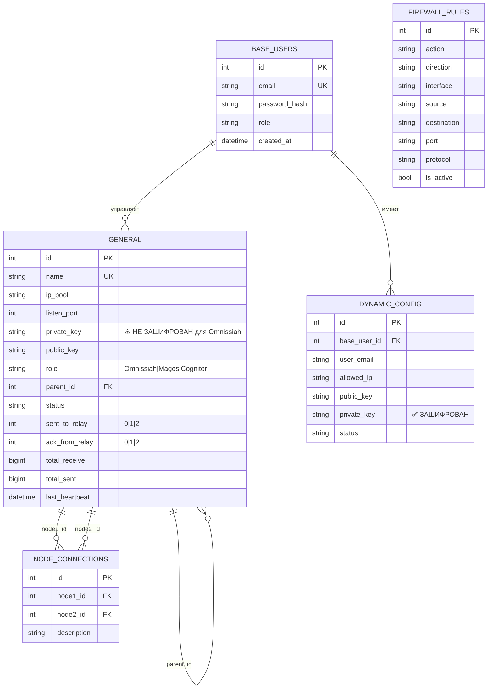

# Структура базы данных после создания главного сервера

## 📌 Краткая справка

После создания главного сервера (Omnissiah) база данных должна содержать:

### Обязательные таблицы и минимальное содержимое:

1. **`base_users`** (1 запись)
   - Администратор: `Adeptus` / `Mechanicus`

2. **`general`** (1 запись)
   - Главный сервер с `role='Omnissiah'`
   - ⚠️ `private_key` хранится **НЕ ЗАШИФРОВАННЫМ**

3. **`firewall_rules`** (N записей)
   - Правила, импортированные из системы iptables

4. **`node_connections`** (0 записей)
   - Обычно пусто после создания главного сервера

5. **Динамические таблицы** (опционально)
   - `{interface_name}` и `{interface_name}_info`
   - Создаются только если интерфейс WireGuard уже существует в системе

## 📊 Таблицы базы данных

База данных `instance/vpngate.db` (SQLite) содержит следующие таблицы:

### 1. `base_users` - Пользователи системы

**Назначение:** Хранит учетные данные администраторов и пользователей веб-интерфейса

**Структура:**
```sql
CREATE TABLE base_users (
    id INTEGER PRIMARY KEY,
    email VARCHAR(120) UNIQUE NOT NULL,
    password_hash VARCHAR(256) NOT NULL,
    created_at DATETIME,
    role VARCHAR(20) DEFAULT 'user'
);
```

**Данные после первого запуска:**
```sql
INSERT INTO base_users (id, email, password_hash, created_at, role)
VALUES (
    1,
    'Adeptus',
    'scrypt:32768:8:1$...',  -- Хеш пароля 'Mechanicus'
    '2025-10-31 15:26:36',
    'admin'
);
```

**Описание полей:**
- `id` - Уникальный идентификатор пользователя
- `email` - Email адрес (уникальный, используется для входа)
- `password_hash` - Хеш пароля (Werkzeug scrypt)
- `created_at` - Дата создания
- `role` - Роль: `'admin'` | `'user'`

---

### 2. `general` - Все узлы сети (Omnissiah, Magos, Cognitor)

**Назначение:** Основная таблица для хранения информации о всех узлах сети (главный сервер, ретрансляторы, клиенты)

**Структура:**
```sql
CREATE TABLE general (
    id INTEGER PRIMARY KEY,
    name VARCHAR(50) UNIQUE NOT NULL,
    ip_pool VARCHAR(50) NOT NULL,
    listen_port INTEGER NOT NULL,
    private_key VARCHAR(256) NOT NULL,
    public_key VARCHAR(256) NOT NULL,
    dns VARCHAR(50) DEFAULT '1.1.1.1',
    mtu INTEGER DEFAULT 1420,
    post_up VARCHAR(500),
    post_down VARCHAR(500),
    created_at DATETIME,
    status VARCHAR(20) DEFAULT 'stopped',
    endpoint VARCHAR(100),
    communication VARCHAR(500),
    role VARCHAR(20) DEFAULT 'Omnissiah',
    preshared_key VARCHAR(256),
    parent_id INTEGER,
    last_handshake DATETIME,
    total_receive BIGINT DEFAULT 0,
    total_sent BIGINT DEFAULT 0,
    last_heartbeat DATETIME,
    sent_to_relay INTEGER DEFAULT 0,
    ack_from_relay INTEGER DEFAULT 0,
    FOREIGN KEY(parent_id) REFERENCES general(id)
);
```

**Данные после создания главного сервера:**
```sql
INSERT INTO general (
    id, name, ip_pool, listen_port, private_key, public_key,
    dns, mtu, created_at, status, endpoint, role, parent_id,
    sent_to_relay, ack_from_relay
) VALUES (
    1,
    'wg0',                    -- Имя интерфейса
    '10.0.0.1/24',            -- IP адрес/маска
    51820,                    -- Порт WireGuard
    'WG_PRIVATE_KEY_HERE',    -- ⚠️ НЕ ЗАШИФРОВАН для главного сервера!
    'WG_PUBLIC_KEY_HERE',     -- Публичный ключ
    '1.1.1.1',                -- DNS сервер
    1420,                     -- MTU
    '2025-10-31 15:30:00',    -- Дата создания
    'stopped',                -- Статус (активация вручную)
    '123.456.789.0',          -- Внешний endpoint
    'Omnissiah',                -- Роль: главный сервер
    NULL,                     -- parent_id = NULL (нет родителя)
    0,                        -- sent_to_relay (не применимо для Omnissiah)
    0                         -- ack_from_relay (не применимо для Omnissiah)
);
```

**Описание полей:**
- `id` - Уникальный ID узла
- `name` - Имя интерфейса WireGuard (уникальное)
- `ip_pool` - IP адрес/маска (например, `10.0.0.1/24`)
- `listen_port` - Порт для прослушивания WireGuard
- `private_key` - Приватный ключ WireGuard
  - ⚠️ **Для главного сервера НЕ шифруется** (сохраняется в открытом виде)
  - ✅ **Для клиентов шифруется** через `get_cipher_suite().encrypt()`
- `public_key` - Публичный ключ WireGuard
- `dns` - DNS сервер по умолчанию
- `mtu` - Размер MTU (Maximum Transmission Unit)
- `post_up` / `post_down` - Скрипты для выполнения при поднятии/опускании интерфейса
- `created_at` - Дата создания узла
- `status` - Статус: `'active'` | `'inactive'` | `'stopped'` | `'pending'`
- `endpoint` - Внешний IP адрес или домен для подключения
- `communication` - Дополнительная информация о коммуникации
- `role` - Роль узла: `'Omnissiah'` | `'Magos'` | `'Cognitor'`
- `preshared_key` - Опциональный preshared key для дополнительной безопасности
- `parent_id` - Ссылка на родительский узел
  - Для `Omnissiah`: `NULL` (главный сервер)
  - Для `Magos`: ID главного сервера
  - Для `Cognitor`: ID ретранслятора или главного сервера
- `last_handshake` - Время последнего handshake с WireGuard peer
- `total_receive` / `total_sent` - Общий объем переданных данных (в байтах)
- `last_heartbeat` - Время последнего heartbeat от узла (для мониторинга)
- `sent_to_relay` - Флаг отправки на ретранслятор:
  - `0` = Не отправлено
  - `1` = Отправлено
  - `2` = Запрос на удаление
- `ack_from_relay` - Флаг подтверждения от ретранслятора:
  - `0` = Не подтверждено
  - `1` = Подтверждено
  - `2` = Удалено

---

### 3. `firewall_rules` - Правила межсетевого экрана

**Назначение:** Хранит правила iptables для управления сетевой безопасностью

**Структура:**
```sql
CREATE TABLE firewall_rules (
    id INTEGER PRIMARY KEY,
    action VARCHAR(10) NOT NULL DEFAULT 'deny',
    direction VARCHAR(10) NOT NULL DEFAULT 'in',
    interface VARCHAR(50) NOT NULL DEFAULT 'any',
    source VARCHAR(50) NOT NULL DEFAULT 'any',
    destination VARCHAR(50) NOT NULL DEFAULT 'any',
    port VARCHAR(20),
    protocol VARCHAR(10) NOT NULL DEFAULT 'any',
    comment VARCHAR(255),
    is_active BOOLEAN DEFAULT TRUE,
    created_at DATETIME,
    updated_at DATETIME
);
```

**Данные после инициализации:**
```sql
-- Правила импортируются из системы при первом запуске
-- через функцию import_system_iptables_rules()

-- Пример правил:
INSERT INTO firewall_rules (action, direction, interface, source, destination, port, protocol, is_active)
VALUES
    ('ACCEPT', 'in', 'any', 'any', 'any', '22', 'tcp', TRUE),   -- SSH
    ('ACCEPT', 'in', 'any', 'any', 'any', NULL, 'icmp', TRUE),  -- ICMP
    ('DENY', 'in', 'any', 'any', 'any', NULL, 'any', TRUE);     -- По умолчанию
```

**Описание полей:**
- `action` - Действие: `'ACCEPT'` | `'DENY'` | `'REJECT'`
- `direction` - Направление: `'in'` | `'out'` | `'forward'`
- `interface` - Интерфейс или `'any'`
- `source` / `destination` - IP адрес источника/назначения
- `port` - Порт или диапазон портов (например, `'80'` или `'8000:9000'`)
- `protocol` - Протокол: `'tcp'` | `'udp'` | `'icmp'` | `'any'`
- `comment` - Комментарий к правилу
- `is_active` - Активно ли правило

---

### 4. `node_connections` - Связи между узлами

**Назначение:** Описывает дополнительные логические связи между узлами (не WireGuard туннели, а административные связи)

**Структура:**
```sql
CREATE TABLE node_connections (
    id INTEGER PRIMARY KEY,
    node1_id INTEGER NOT NULL,
    node2_id INTEGER NOT NULL,
    description VARCHAR(200),
    created_at DATETIME,
    FOREIGN KEY(node1_id) REFERENCES general(id),
    FOREIGN KEY(node2_id) REFERENCES general(id),
    UNIQUE(node1_id, node2_id)
);
```

**Данные после создания главного сервера:**
```sql
-- Обычно пусто, создается при ручном управлении связями через веб-интерфейс
-- Используется для дополнительной маршрутизации или логической группировки
```

**Описание полей:**
- `node1_id` / `node2_id` - Связанные узлы
- `description` - Описание связи
- `created_at` - Дата создания связи

---

### 5. Динамические таблицы для интерфейсов WireGuard

**Назначение:** Создаются автоматически для каждого существующего интерфейса WireGuard

**Правило именования:**
- Таблица конфигураций: `{interface_name}` (например, `wg0`)
- Таблица информации: `{interface_name}_info` (например, `wg0_info`)

#### 5.1. `{interface_name}` - Конфигурации пользователей для интерфейса

```sql
CREATE TABLE {interface_name} (
    id INTEGER PRIMARY KEY,
    base_user_id INTEGER,
    user_email VARCHAR(255),
    allowed_ip VARCHAR(15),
    public_key VARCHAR(256),
    private_key VARCHAR(256),  -- ЗАШИФРОВАН через Fernet
    api_peer_id VARCHAR(50),
    latest_handshake DATETIME,
    server_conf TEXT,
    dns VARCHAR(50),
    endpoint_allowed_ip VARCHAR(100),
    total_receive BIGINT,
    total_sent BIGINT,
    total_data BIGINT,
    status VARCHAR(20) DEFAULT 'pending',
    cumu_receive BIGINT,
    cumu_sent BIGINT,
    cumu_data BIGINT,
    old_endpoint VARCHAR(100),
    real_endpoint VARCHAR(100),
    FOREIGN KEY(base_user_id) REFERENCES base_users(id)
);
```

**Использование:** Для управления пользователями, которые подключаются к конкретному интерфейсу (старая функциональность)

#### 5.2. `{interface_name}_info` - Информация об интерфейсе

```sql
CREATE TABLE {interface_name}_info (
    id INTEGER PRIMARY KEY,
    address VARCHAR(50),
    connected_peers INTEGER,
    receive FLOAT,
    sent FLOAT,
    total FLOAT,
    listen_port VARCHAR(10),
    name VARCHAR(50),
    post_down VARCHAR(500),
    post_up VARCHAR(500),
    pre_down VARCHAR(500),
    pre_up VARCHAR(500),
    public_key VARCHAR(256),
    save_config BOOLEAN,
    status BOOLEAN,
    mtu INTEGER,
    persistent_keepalive INTEGER,
    preshared_key VARCHAR(256)
);
```

**Использование:** Хранит статистику и конфигурацию интерфейса, синхронизируется из системы через `wg show`

---

## 📋 Итоговое состояние БД после создания главного сервера

### Минимальный набор данных:

```sql
-- 1. Администратор (создается автоматически)
base_users:
  id: 1
  email: 'Adeptus'
  password_hash: 'scrypt:...'
  role: 'admin'

-- 2. Главный сервер (создается через /setup_wizard)
general:
  id: 1
  name: 'wg0' (или другое имя из формы)
  ip_pool: '10.0.0.1/24' (из формы)
  listen_port: 51820 (из формы)
  private_key: '...' (⚠️ НЕ ЗАШИФРОВАН)
  public_key: '...'
  role: 'Omnissiah'
  status: 'stopped'
  parent_id: NULL
  sent_to_relay: 0
  ack_from_relay: 0

-- 3. Правила firewall (импортируются из системы)
firewall_rules:
  - Правила из текущей конфигурации iptables

-- 4. Динамические таблицы (если интерфейс уже существует)
wg0: (может быть пусто)
wg0_info: (может быть пусто или содержать данные из системы)
```

---

## 🔄 Изменения БД при работе системы

### После создания ретранслятора (Magos):

```sql
general:
  id: 2
  name: 'relay1'
  role: 'Magos'
  parent_id: 1  -- Ссылка на главный сервер
  sent_to_relay: 0
  ack_from_relay: 0
```

### После создания клиента (Cognitor):

```sql
general:
  id: 3
  name: 'client1'
  role: 'Cognitor'
  parent_id: 2  -- Ссылка на ретранслятор
  sent_to_relay: 0  -- Не отправлен на ретранслятор
  ack_from_relay: 0

-- После отправки на ретранслятор:
  sent_to_relay: 1  -- Отправлено
  ack_from_relay: 1  -- Подтверждено
```

---

## 🔍 Примеры запросов для проверки состояния

### Проверка главного сервера:
```sql
SELECT id, name, role, ip_pool, status, endpoint, created_at
FROM general
WHERE role = 'Omnissiah';
```

### Проверка всех узлов с их родителями:
```sql
SELECT 
    g.id,
    g.name,
    g.role,
    g.ip_pool,
    p.name AS parent_name,
    p.role AS parent_role
FROM general g
LEFT JOIN general p ON g.parent_id = p.id
ORDER BY g.role, g.id;
```

### Проверка клиентов, ожидающих отправки:
```sql
SELECT id, name, ip_pool, parent_id
FROM general
WHERE role = 'Cognitor'
  AND sent_to_relay = 0;
```

### Статистика узлов:
```sql
SELECT 
    role,
    COUNT(*) AS count,
    SUM(CASE WHEN status = 'active' THEN 1 ELSE 0 END) AS active,
    SUM(total_receive) AS total_rx,
    SUM(total_sent) AS total_tx
FROM general
GROUP BY role;
```

---

## 📊 Визуальная схема связей между таблицами



## 📐 Структура данных после создания главного сервера (табличная форма)

### Таблица: `base_users`
| id | email | password_hash | role | created_at |
|----|-------|---------------|------|------------|
| 1 | Adeptus | scrypt:... | admin | 2025-10-31 15:26:36 |

### Таблица: `general` (главный сервер)
| id | name | ip_pool | listen_port | private_key | public_key | role | status | parent_id | sent_to_magos | ack_from_magos |
|----|------|---------|-------------|-------------|------------|------|--------|-----------|----------------|----------------|
| 1 | wg0 | 10.0.0.1/24 | 51820 | WG_PRIV_KEY | WG_PUB_KEY | Omnissiah | stopped | NULL | 0 | 0 |

### Таблица: `firewall_rules` (примеры)
| id | action | direction | interface | source | destination | port | protocol | is_active |
|----|--------|-----------|-----------|--------|-------------|------|----------|-----------|
| 1 | ACCEPT | in | any | any | any | 22 | tcp | TRUE |
| 2 | ACCEPT | in | any | any | any | NULL | icmp | TRUE |
| 3 | DENY | in | any | any | any | NULL | any | TRUE |

### Таблица: `node_connections`
| id | node1_id | node2_id | description | created_at |
|----|----------|----------|-------------|------------|
| *(пусто после создания главного сервера)* |

### Динамические таблицы (пример: `wg0` и `wg0_info`)
| Таблица | Содержимое после создания главного сервера |
|---------|-------------------------------------------|
| `wg0` | Может быть пусто или содержать существующие конфигурации пользователей |
| `wg0_info` | Может быть пусто или содержать данные из системы (`wg show`) |

## 🔄 Жизненный цикл данных

### Сценарий: Создание главного сервера

```
1. init_db() вызывается при запуске
   ├─ Создает таблицы (если не существуют)
   ├─ Создает администратора (если base_users пусто)
   └─ Импортирует правила firewall из системы

2. Пользователь создает главный сервер через /setup_wizard
   ├─ INSERT INTO general
   │   ├─ name: из формы
   │   ├─ ip_pool: из формы
   │   ├─ listen_port: из формы
   │   ├─ private_key: сгенерирован (НЕ ЗАШИФРОВАН)
   │   ├─ public_key: сгенерирован
   │   ├─ role: 'Omnissiah'
   │   ├─ status: 'stopped'
   │   └─ parent_id: NULL
   └─ Создание файла /etc/wireguard/{name}.conf

3. Результат:
   ├─ base_users: 1 запись (администратор)
   ├─ general: 1 запись (главный сервер)
   ├─ firewall_rules: N записей (из системы)
   └─ node_connections: 0 записей
```

### Сценарий: Добавление ретранслятора

```
4. Пользователь создает ретранслятор через /setup_wizard
   ├─ INSERT INTO general
   │   ├─ role: 'Magos'
   │   ├─ parent_id: 1 (ID главного сервера)
   │   └─ sent_to_relay: 0, ack_from_relay: 0
   └─ Добавление peer к главному серверу (wg set)

5. Результат:
   ├─ general: 2 записи (1 Omnissiah + 1 Magos)
   └─ Связь: Magos.parent_id → Omnissiah.id
```

### Сценарий: Добавление клиента

```
6. Пользователь создает клиента через /add_peer
   ├─ INSERT INTO general
   │   ├─ role: 'Cognitor'
   │   ├─ parent_id: 2 (ID ретранслятора)
   │   └─ sent_to_relay: 0, ack_from_relay: 0
   │
   ├─ HTTP POST → Magos: /api/add_peer
   │
   └─ UPDATE general
       ├─ sent_to_relay: 1
       └─ ack_from_relay: 1 (после подтверждения)

7. Результат:
   ├─ general: 3 записи (1 Omnissiah + 1 Magos + 1 Cognitor)
   └─ Связь: Cognitor.parent_id → Magos.id
```

## ⚠️ Важные замечания

1. **Private key главного сервера НЕ шифруется** в БД (в отличие от клиентов)
2. **Динамические таблицы** создаются только для существующих интерфейсов WireGuard
3. **Таблица `node_connections`** используется для дополнительных логических связей, не для WireGuard туннелей
4. **Firewall rules** импортируются из системы при первом запуске
5. **Foreign keys** обеспечивают целостность данных между таблицами

